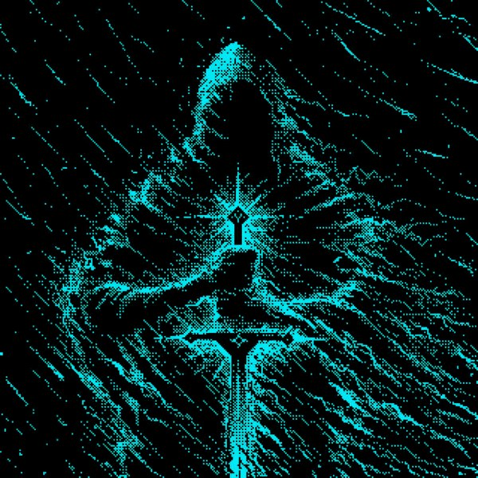
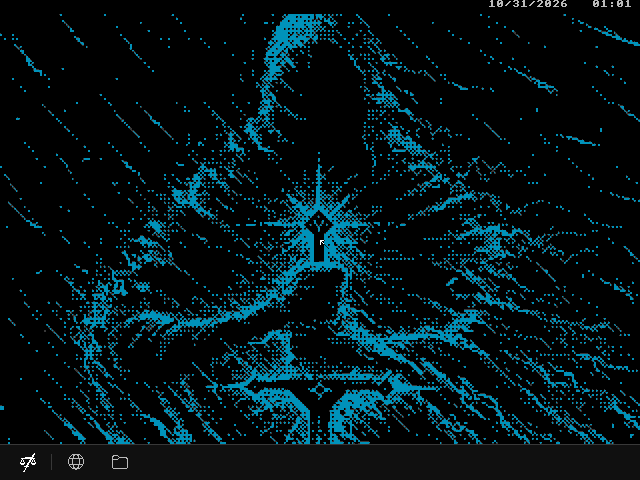
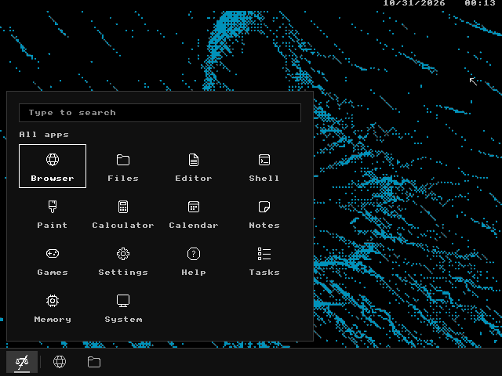
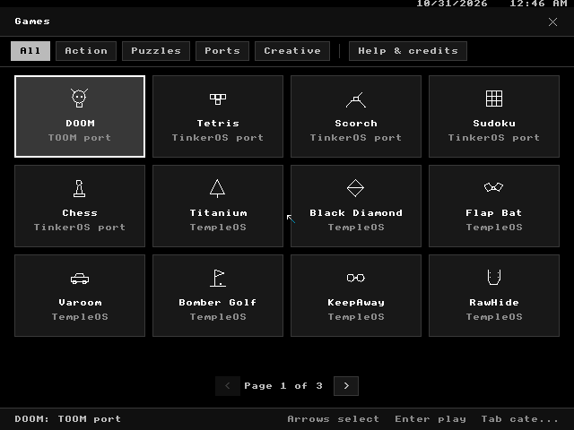
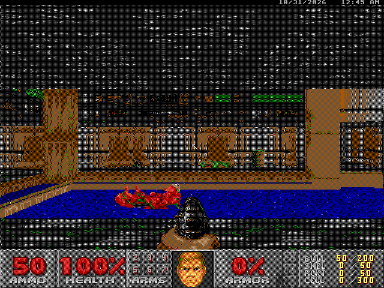

<p align="center">
  
</p>

<h1 align="center">Relic OS</h1>

<p align="center">
  A fork of TempleOS with a clean desktop, everyday apps and games.<br>
  A tribute to Terry A. Davis.
</p>

<p align="center">
  <a href="https://github.com/SunSinD/Relic-OS/releases/latest"><b>Download the ISO</b></a> |
  <a href="CHANGELOG.md">Changelog</a> |
  <a href="roadmap/README.md">Roadmap</a>
</p>

<p align="center">
  
  
</p>

## What's inside

Everything from TempleOS (HolyC, the shell, the editor, the original font and
Terry's games), plus:

- A matte-black desktop with a taskbar and a searchable Start menu
- Browser, Files, Paint, Calculator, Calendar, Notes and Settings
- 28 games, including DOOM, Tetris, Chess and Sudoku
- Networking (plain HTTP pages, no HTTPS yet)
- A live CD that can install itself to a disk

<p align="center">
  
  
</p>

## Try it

1. Download `RelicOS-v0.5.0.iso` from the [latest release](https://github.com/SunSinD/Relic-OS/releases/latest).
2. Make a VM: **Other 64-bit, BIOS** (not UEFI), 2 GB RAM, an **IDE** disk if you want to install.
3. Boot the ISO. Press **C** to try it live, or **I** to install.

QEMU:

```sh
qemu-system-x86_64 -m 2G -smp 2 -cdrom RelicOS-v0.5.0.iso -boot d
```

Tested in VMware Workstation and QEMU. Real hardware needs a BIOS (legacy)
PC; most modern laptops won't boot it.

Click the logo at the bottom left (or press Space) for the Start menu.
Type `help` in the Shell for commands.

## Build

Windows, Python 3 and VMware Workstation: `tools\relic.ps1 dev` boots the dev
VM, `tools\relic.ps1 iso` builds the ISO.

## License

Relic OS code is MIT. TempleOS is public domain. Other parts keep their own
licenses ([NOTICE.md](NOTICE.md)).

<p align="center">
  <em>In memory of Terry A. Davis (1969-2018).</em>
</p>
